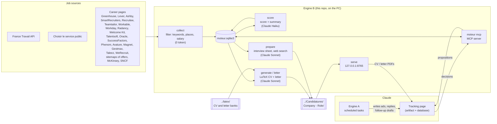
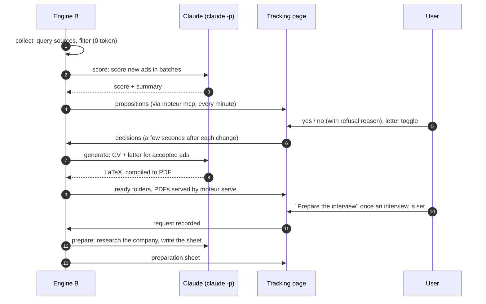

# Local job application engine

A personal job-search pipeline. The engine (**engine B**, this repository) collects and
filters job ads in plain code (zero tokens), then calls Claude through `claude -p`
(subscription, no API key) only where judgment is needed: scoring ads, writing a
tailored CV and cover letter from the LaTeX repository `../latex/`, and preparing
interviews.

It works together with two other pieces, all kept in this repository:

| Piece | Where it runs | Folder |
| --- | --- | --- |
| **Engine B** — collection, scoring, CV and letter generation | on the PC | [`src/moteur/`](src/moteur/) |
| **Tracking page** "Application tracker" (English or French, flag menu) — where every application is sorted and followed | claude.ai artifact with its own database | [`page-suivi/`](page-suivi/README.md) |
| **Engine A** — Claude scheduled tasks that search the web and the mailbox | in Claude | [`taches/`](taches/README.md) |

## How it fits together



The life of an application, from the engine's point of view:



## Installation

```bash
uv sync
cp config.exemple.toml config.toml   # then adapt profile and criteria
```

Large groups and public bodies come with the tool, in
[`catalogue/entreprises.toml`](catalogue/entreprises.toml): untick the ones that do not
interest you in the page's **Options** panel (or check with `uv run moteur companies`).
The same panel changes the search criteria (keywords, exclusions, locations, countries,
search terms) and turns the keyword sources on or off: `config.toml` only gives the
defaults.
Your own companies (start-ups, small companies) are added by Claude: see
[Adding companies](#adding-companies). `config.toml` lists no company.

Coming from a version whose `config.toml` listed `[[entreprises]]`: run
`uv run moteur import-companies` once, then delete them from `config.toml`.

`claude` must be installed and logged in with your subscription:

```bash
claude auth status
```

**France Travail** needs API credentials. Put them in a `.env` file (ignored by Git) next
to `config.toml`; it is read automatically, and a variable already set in the shell
takes precedence:

```bash
FRANCE_TRAVAIL_ID=...
FRANCE_TRAVAIL_SECRET=...
```

**Choisir le service public** (French State jobs: Ministries of the Armed Forces and the
Interior, DGSE, DGSI, DINUM, AMIAD, ANSSI…) needs no credentials: set keywords, fields and
employers in `[service_public]`.

### CV and letters: the `latex/` folder

CVs and letters are written in LaTeX and compiled with XeLaTeX. Install a TeX
distribution with `latexmk`, XeLaTeX and the `noto`, `lato`, `raleway`, `fontawesome`
packages (TeX Live full has them all), plus `pdfinfo` (poppler):

```bash
sudo apt install texlive-full latexmk poppler-utils   # Debian / Ubuntu
sudo pacman -S texlive texlive-langfrench poppler     # Arch / Manjaro
```

The engine writes from your own `latex/` folder, next to `moteur/` (under the root folder,
`..` by default). It stays outside the repository. Start from the example shipped here,
written for a fictional person (Jane Doe):

```bash
uv run moteur init-latex   # copies latex-exemple/ to ../latex/
```

Then replace Jane Doe with yourself:

| File | What to put in it |
| --- | --- |
| `commun/coordonnees.tex` | name, e-mail, phone, LinkedIn, years of experience |
| `cv/banque-fr.tex`, `cv/banque-en.tex` | **every** block you may want on a CV: titles, headlines with their `% Usage :` comment, skills, bullets, projects, interests. Claude only picks blocks; it never writes text |
| `cv/modele-cv.tex` | your reference CV, built from the bank's macros |
| `lettres/banque-paragraphes.md` | validated letter paragraphs: Claude invents no fact about you |
| `consignes-cv.md`, `consignes-lettre.md` | your own rules for Claude (optional) |

The engine relies on a few conventions: the main experience is the first
`\explanationdetail` of the Experience section, its bullets are `\p…` macros, projects
are `\proj…` macros. They are what gets removed to fit the CV on one page. The full
contract is [`specs/latex-repository.md`](specs/latex-repository.md); the comments at the
top of the example's templates sum it up. `generate` stops with the list of missing files
if the folder is incomplete.

Optional: `suivi/entreprises_vues.csv` under the root folder (columns
`entreprise;…;statut`) lists companies already approached.

## Usage

```bash
uv run moteur daily              # collect + score + company links + export
uv run moteur generate           # CV and letter in ../Candidatures/<Company - Role>/
uv run moteur serve              # keep running: the page's CV / Letter buttons open your PDFs
uv run moteur prepare            # pending interview preparation sheets
```

| Command | What it does | Claude |
| --- | --- | --- |
| `init-latex` | copies the LaTeX example to `../latex/` | no |
| `collect` | queries the sources and filters | no |
| `score` | scores the new ads | Haiku |
| `links` | looks up the missing company website and LinkedIn page (web search) | Haiku |
| `export` | writes the file to import into the page | no |
| `daily` | `collect`, `score`, `links`, then `export` | Haiku |
| `decisions <file>` | reads the page's export | no |
| `generate` | prepares CV and letter for accepted ads | Sonnet |
| `letter [ids…]` | adds the missing letter to folders whose CV already exists | Sonnet |
| `prepare [ids…]` | interview preparation sheets (all pending requests by default) | Sonnet |
| `mcp` | direct link with the page, started by the Claude desktop app | no |
| `detect <urls…>` | recognises the recruiting tool behind career pages | no |
| `companies` | lists the companies followed and the sources, with what is searched | no |
| `import-companies` | keeps the `[[entreprises]]` of an older `config.toml` as your own companies | no |
| `serve [--port]` | serves CVs and letters for the page's links | no |

Add `-v` to any command for per-source details. The Claude models are the defaults and
can be changed in `[modeles]` of `config.toml`.

### Direct link with the page (`moteur mcp`)

When the page is open in the Claude desktop app on this PC, it talks to engine B through
an MCP server (rules ECH-20 to ECH-25, PAGE-35 to PAGE-38): it imports proposals and
ready folders at load and every minute, and sends its decisions a few seconds after each
change. No JSON file to move by hand. The app starts the server itself; declare it once
in `~/.config/Claude/claude_desktop_config.json`, then restart the app:

```json
{
  "mcpServers": {
    "moteur": {
      "command": "/usr/bin/uv",
      "args": ["--directory", "/path/to/moteur", "run", "moteur", "mcp"]
    }
  }
}
```

The "Moteur B" chip in the page header shows whether the link is up.

### Adding companies

Ask Claude in the desktop app: "add Doctolib", "find cybersecurity SMEs hiring in Lyon".
The skill [`skills/trouver-entreprises`](skills/trouver-entreprises/SKILL.md) tells it how:
it reads what engine B already follows, searches the web, shows you what it found, then
hands the companies you keep to the tool `ajouter_entreprises` of `moteur mcp`. Engine B
queries each company's job board before keeping it, and says why it refuses one
([`specs/catalogue.md`](specs/catalogue.md), CAT-20 and following). `retirer_entreprises`
removes one. Install the skill once: zip the `skills/trouver-entreprises` folder and
upload it in the desktop app's settings (Capabilities, Skills).

### Interview preparation

On an application marked *Postulée* whose follow-up is *Entretien*, the page's
"Prepare the interview" button records a request. `moteur mcp` then starts
`moteur prepare` in the background, which writes `preparation-entretien.md` in the
application's folder and sends the sheet back to the page
([`specs/interview-prep.md`](specs/interview-prep.md)). The output of the last
background run is in `echange/preparation.log`.

### Fallback: JSON files

Elsewhere (phone, browser, app closed), exchange by hand:

```bash
uv run moteur export                                           # then import echange/pour-la-page.json in the page
```

```bash
uv run moteur decisions ~/Downloads/candidatures-export.json   # after "Export" in the page
```

### Why a local server and an MCP link?

- The page cannot `fetch()` the PC: the artifact platform blocks every call to another
  host, `127.0.0.1` included. Only the MCP server gets through, via the desktop app.
- The page lives on claude.ai, where the browser blocks `file://` links. `serve`
  therefore exposes **only** `../Candidatures/`, read-only, on `http://127.0.0.1:8765`
  (`--port` to change it; the page assumes 8765).

## Personal data

The repository contains no personal data. It stays in files ignored by Git or outside
the repository:

| File | Content |
| --- | --- |
| `config.toml` | profile sent to Claude, criteria, salary floor |
| `.env` | France Travail credentials |
| `moteur.sqlite3`, `echange/` | ads seen, scores, decisions, your own companies and choices |
| `../latex/` | CV, block and paragraph banks, personal instructions, `compiler.sh` |
| `../Candidatures/`, `../suivi/` | generated folders, companies already approached |
| `prive/` | export of the page's database, filled-in text of the scheduled tasks |

## Reinstalling from scratch

1. Publish the tracking page ([`page-suivi/README.md`](page-suivi/README.md)).
2. Create the scheduled tasks from their templates ([`taches/README.md`](taches/README.md)).
3. Configure the engine ([Installation](#installation)) and declare `moteur mcp` in the
   desktop app.

## Specs

Expected behaviour is described rule by rule in [`specs/`](specs/README.md). The specs
are the reference: a change in behaviour starts with the spec. Every engine rule is
checked by a test that cites it (`@pytest.mark.spec("FILT-03")`);
`tests/test_specs.py` fails if one is missing.

## Code layout

| Module | Role | Claude |
| --- | --- | --- |
| `sources/` | France Travail, Choisir le service public, ATS career pages (`ats.py`), Workday, Radancy, Welcome Kit, Talentsoft, Oracle, SuccessFactors, Phenom, Avature, Magnet, Gestmax, Taleez, WeRecruit, sitemaps of offers, McKinsey, SNCF | no |
| `filtering.py` | keywords, exclusions, places, salary | no |
| `collection.py` | gathers the sources, suggests unsolicited applications | no |
| `local_db.py` | SQLite: seen, scored, to generate | no |
| `scoring.py` | score and summary, in batches | Haiku |
| `refusal.py` | refusal reasons shared by the page, the database and scoring | no |
| `generation.py` | LaTeX CV and letter, compilation | Sonnet |
| `latex_repository.py` | `latex/` folder: required files, personal instructions, `init-latex` | no |
| `cover_letter.py` | letter alone, for a folder whose CV exists | Sonnet |
| `interview_prep.py` | interview preparation sheet, with web search | Sonnet |
| `claude_cli.py` | calls to `claude -p` | — |
| `exchange.py` | files exchanged with the tracking page | no |
| `decisions.py` | applies the page's decisions (file or direct link) | no |
| `mcp_link.py` | MCP server `moteur mcp`, direct link with the page | no |
| `pdf_server.py` | serves the PDFs of `Candidatures/` to the page | no |
| `detection.py` | `moteur detect`: finds a company's recruiting tool | no |
| `own_companies.py` | your own companies: board check, add, remove, import | no |

Application identifiers (`Offre.cle`) are computed exactly as in the tracking page
([`specs/identifiers.md`](specs/identifiers.md)): never change `normaliser` on one side
only.

## Quality checks

The same checks run on GitHub Actions on every push to `main` and every pull request:

```bash
uv run ruff format . && uv run ruff check . && uv run mypy && uv run pytest
```
