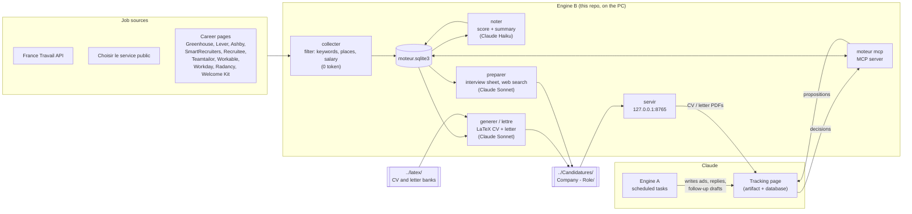
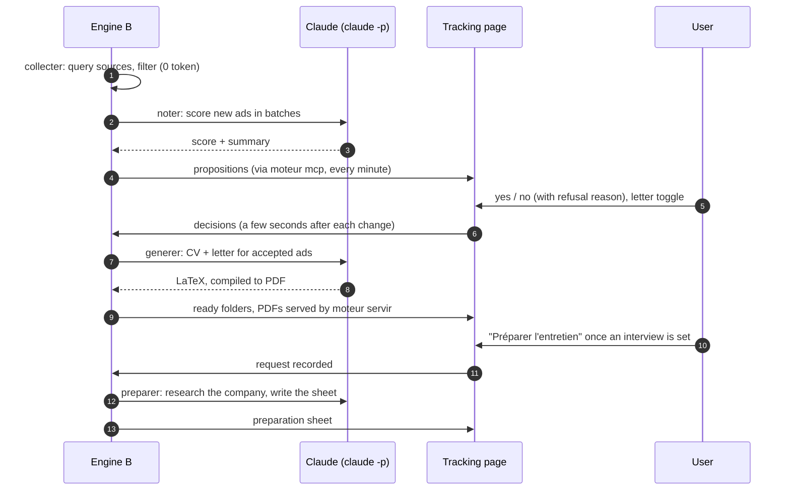

# Local job application engine

A personal job-search pipeline. The engine (**engine B**, this repository) collects and
filters job ads in plain code (zero tokens), then calls Claude through `claude -p`
(subscription, no API key) only where judgment is needed: scoring ads, writing a
tailored CV and cover letter from the LaTeX repository `../latex/`, and preparing
interviews.

It works together with two other pieces, all kept in this repository:

| Piece | Where it runs | Folder |
| --- | --- | --- |
| **Engine B** — collection, scoring, CV and letter generation | on the PC | [`src/moteur/`](src/moteur/) |
| **Tracking page** "Suivi des candidatures" — where every application is sorted and followed | claude.ai artifact with its own database | [`page-suivi/`](page-suivi/README.md) |
| **Engine A** — Claude scheduled tasks that search the web and the mailbox | in Claude | [`taches/`](taches/README.md) |

## How it fits together



The life of an application, from the engine's point of view:



## Installation

```bash
uv sync
cp config.exemple.toml config.toml   # then adapt criteria and companies
```

`claude` must be installed and logged in with your subscription:

```bash
claude auth status
```

**France Travail** needs API credentials. Put them in a `.env` file (ignored by Git) next
to `config.toml`; it is read automatically, and a variable already set in the shell
takes precedence:

```bash
FRANCE_TRAVAIL_ID=...
FRANCE_TRAVAIL_SECRET=...
```

**Choisir le service public** (French State jobs: Ministries of the Armed Forces and the
Interior, DGSE, DGSI, DINUM, AMIAD, ANSSI…) needs no credentials: set keywords, fields and
employers in `[service_public]`.

### Expected folder layout

The parent folder (`racine` in `[chemins]`, `..` by default) must contain:

```text
latex/
  compiler.sh                       # compiles a folder; reports "<name>.pdf fait N pages"
  cv/modele-cv.tex                  # starting CV, with \def\latexroot{...}
  cv/banque-fr.tex, banque-en.tex   # allowed block macros
  lettres/modele-lettre.tex         # letter skeleton
  lettres/banque-paragraphes.md
suivi/entreprises_vues.csv          # optional: columns "entreprise;…;statut"
```

## Usage

```bash
uv run moteur quotidien          # collect + score + company links + export
uv run moteur generer            # CV and letter in ../Candidatures/<Company - Role>/
uv run moteur servir             # keep running: the page's CV / Letter buttons open your PDFs
uv run moteur preparer           # pending interview preparation sheets
```

| Command | What it does | Claude |
| --- | --- | --- |
| `collecter` | queries the sources and filters | no |
| `noter` | scores the new ads | Haiku |
| `liens` | looks up the missing company website and LinkedIn page (web search) | Haiku |
| `exporter` | writes the file to import into the page | no |
| `quotidien` | `collecter`, `noter`, `liens`, then `exporter` | Haiku |
| `decisions <file>` | reads the page's export | no |
| `generer` | prepares CV and letter for accepted ads | Sonnet |
| `lettre [ids…]` | adds the missing letter to folders whose CV already exists | Sonnet |
| `preparer [ids…]` | interview preparation sheets (all pending requests by default) | Sonnet |
| `mcp` | direct link with the page, started by the Claude desktop app | no |
| `detecter <urls…>` | recognises the recruiting tool behind career pages | no |
| `servir [--port]` | serves CVs and letters for the page's links | no |

Add `-v` to any command for per-source details. The Claude models are the defaults and
can be changed in `[modeles]` of `config.toml`.

### Direct link with the page (`moteur mcp`)

When the page is open in the Claude desktop app on this PC, it talks to engine B through
an MCP server (rules ECH-20 to ECH-25, PAGE-35 to PAGE-38): it imports proposals and
ready folders at load and every minute, and sends its decisions a few seconds after each
change. No JSON file to move by hand. The app starts the server itself; declare it once
in `~/.config/Claude/claude_desktop_config.json`, then restart the app:

```json
{
  "mcpServers": {
    "moteur": {
      "command": "/usr/bin/uv",
      "args": ["--directory", "/path/to/moteur", "run", "moteur", "mcp"]
    }
  }
}
```

The "Moteur B" chip in the page header shows whether the link is up.

### Interview preparation

On an application marked *Postulée* whose follow-up is *Entretien*, the page's
"Préparer l'entretien" button records a request. `moteur mcp` then starts
`moteur preparer` in the background, which writes `preparation-entretien.md` in the
application's folder and sends the sheet back to the page
([`specs/interview-prep.md`](specs/interview-prep.md)). The output of the last
background run is in `echange/preparation.log`.

### Fallback: JSON files

Elsewhere (phone, browser, app closed), exchange by hand:

```bash
uv run moteur exporter                                         # then import echange/pour-la-page.json in the page
```

```bash
uv run moteur decisions ~/Downloads/candidatures-export.json   # after "Exporter" in the page
```

### Why a local server and an MCP link?

- The page cannot `fetch()` the PC: the artifact platform blocks every call to another
  host, `127.0.0.1` included. Only the MCP server gets through, via the desktop app.
- The page lives on claude.ai, where the browser blocks `file://` links. `servir`
  therefore exposes **only** `../Candidatures/`, read-only, on `http://127.0.0.1:8765`
  (`--port` to change it; the page assumes 8765).

## Personal data

The repository contains no personal data. It stays in files ignored by Git or outside
the repository:

| File | Content |
| --- | --- |
| `config.toml` | profile sent to Claude, criteria, salary floor, followed companies |
| `.env` | France Travail credentials |
| `moteur.sqlite3`, `echange/` | ads seen, scores, decisions |
| `../latex/` | CV, block and paragraph banks, `compiler.sh` |
| `../Candidatures/`, `../suivi/` | generated folders, companies already approached |
| `prive/` | export of the page's database, filled-in text of the scheduled tasks |

## Reinstalling from scratch

1. Publish the tracking page ([`page-suivi/README.md`](page-suivi/README.md)).
2. Create the scheduled tasks from their templates ([`taches/README.md`](taches/README.md)).
3. Configure the engine ([Installation](#installation)) and declare `moteur mcp` in the
   desktop app.

## Specs

Expected behaviour is described rule by rule in [`specs/`](specs/README.md). The specs
are the reference: a change in behaviour starts with the spec. Every engine rule is
checked by a test that cites it (`@pytest.mark.spec("FILT-03")`);
`tests/test_specs.py` fails if one is missing.

## Code layout

| Module | Role | Claude |
| --- | --- | --- |
| `sources/` | France Travail, Choisir le service public, ATS career pages (`ats.py`), Workday, Radancy, Welcome Kit | no |
| `filtre.py` | keywords, exclusions, places, salary | no |
| `collecte.py` | gathers the sources, suggests unsolicited applications | no |
| `base_locale.py` | SQLite: seen, scored, to generate | no |
| `notation.py` | score and summary, in batches | Haiku |
| `refusal.py` | refusal reasons shared by the page, the database and scoring | no |
| `generation.py` | LaTeX CV and letter, compilation | Sonnet |
| `lettre.py` | letter alone, for a folder whose CV exists | Sonnet |
| `preparation.py` | interview preparation sheet, with web search | Sonnet |
| `claude_cli.py` | calls to `claude -p` | — |
| `echange.py` | files exchanged with the tracking page | no |
| `decisions.py` | applies the page's decisions (file or direct link) | no |
| `liaison.py` | MCP server `moteur mcp`, direct link with the page | no |
| `serveur.py` | serves the PDFs of `Candidatures/` to the page | no |
| `detection.py` | `moteur detecter`: finds a company's recruiting tool | no |

Application identifiers (`Offre.cle`) are computed exactly as in the tracking page
([`specs/identifiers.md`](specs/identifiers.md)): never change `normaliser` on one side
only.

## Quality checks

The same checks run on GitHub Actions on every push to `main` and every pull request:

```bash
uv run ruff format . && uv run ruff check . && uv run mypy && uv run pytest
```
